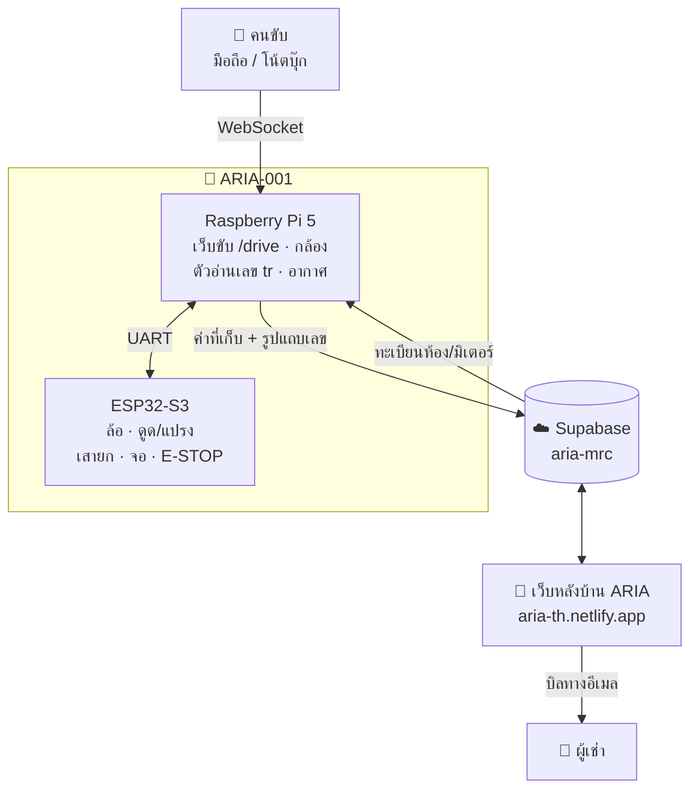

<div align="center">

<picture>
  <source media="(prefers-color-scheme: dark)" srcset="aria/web/img/aria-mark-light.png">
  
</picture>

### Autonomous Refuse-collection & Intelligent Metering Assistant

หุ่นยนต์อเนกประสงค์ **ARIA-001** (รหัสโครงการ MRC-001) — **เก็บขยะ** ด้วยระบบดูด + แปรง และ **อ่านมิเตอร์น้ำ/ไฟ** ด้วยกล้อง
แล้วส่งค่าขึ้น **ระบบหลังบ้านหอพัก** ที่ออกบิลให้ผู้เช่าได้ทันที


**[เว็บหลังบ้าน ARIA](https://aria-th.netlify.app)** · [เอกสารระบบ](01_เอกสารโครงการ/system_architecture.md) · [สมุดคำนวณ](08_การคำนวณ/00_INDEX.md) · [รายงานการทดลองโมเดลอ่านมิเตอร์](01_เอกสารโครงการ/รายงานการทดลองโมเดลอ่านมิเตอร์_2026-10-15.md)

</div>

---

## สถานะ — 17 ต.ค. 2026 · พร้อมแข่ง ✅

| ระบบ | สถานะ |
|---|---|
| ขับเคลื่อนแมนวลผ่านเว็บ `/drive` | ใช้งานได้ · deadman 2 ชั้น (Pi + ESP32 · 300 ms) · watchdog 1 s |
| ดูด + แปรง | ใช้งานได้ · ต่อเวลาเองตราบที่ลิงก์อยู่ · ลิงก์เงียบเกิน 5 s ปิดเอง |
| เสายกกล้อง (scissor เฟืองซิงก์) + มุมกล้อง | ใช้งานได้ · **E-STOP พับเสาลงช้าๆ ก่อนปล่อยสัญญาณ** (ไม่ร่วง) |
| อ่านเลขมิเตอร์ (engine `tr`) | **อ่านถูก 46/48 รูป** · อ่านผิดแต่มั่นใจสูง 0 · แยกน้ำ/ไฟจากรูปทรง 48/49 · ~0.6 s/รูปบน Pi |
| จอสถานะหน้าหุ่น | จอกลม GC9A01 1.28" (มี ST7735 1.8" เป็นทางเลือก) |
| เซนเซอร์อากาศ ENS160 + AHT21 | ใช้งานได้ · แนบค่าอากาศไปกับทุกค่าที่อ่าน |
| ส่งข้อมูลขึ้นคลาวด์ + ดึงทะเบียนห้อง | ทุก 5 นาที · เน็ตหลุดก็ยังขับ/ถ่ายได้ ค่าค้างไว้ส่งทีหลัง |
| เว็บหลังบ้าน ARIA | ยืนยันค่า · ออกบิล · ส่งอีเมล · บันทึกรับเงิน · โหมดผู้ชม |

---

## ระบบทำงานอย่างไร



**จากกดถ่ายถึงบิล**
1. คนขับเล็งกล้องที่มิเตอร์บนหน้า `/drive` แล้วกดถ่าย (ปุ่มหรือคีย์ `C`)
2. ตัวอ่าน `tr` หากล่องมิเตอร์สีน้ำเงิน → แยก**น้ำ (ทรงกระบอก) / ไฟ (สี่เหลี่ยม)** จากรูปทรง → หาแถบตัวเลข → **ดัดภาพจาก 4 มุม** (แก้มุมเอียง/ด้านข้าง) → YOLO อ่านเลข
3. ป๊อปอัพโชว์เลข + ภาพแถบที่ดัดตรงแล้ว + **เลือกปุ่มน้ำ/ไฟให้แล้ว** → คนขับเลือกห้องแล้วกด "เก็บ"
4. Pi ส่งขึ้นคลาวด์ → เจ้าของหอยืนยันค่าบนเว็บ ARIA → อนุมัติบิล → ส่งอีเมลให้ผู้เช่า

---

## ตัวอ่านเลขมิเตอร์

ทดสอบบนรูปจริงจากกล้องบนหุ่น 48 รูปที่มีเลข + 24 รูปที่ไม่มีมิเตอร์ ([ไฟล์ 39](08_การคำนวณ/39_เทียบ5วิธีอ่านมิเตอร์_textreader_2026-10-15.md))

| วิธี | อ่านถูก | อ่านผิดแต่มั่นใจ ≥ 0.8 | หมายเหตุ |
|---|---|---|---|
| **`tr` — หากล่อง → ดัดภาพ → YOLO** (ค่าเริ่มต้น) | **46 / 48** | **0** | ชุดมุมเอียง/ด้านข้าง เลขชุดใหม่ 6/6 |
| `cells` — CNN ทีละช่อง (ทางถอยอัตโนมัติ) | 8 / 48 | 2 | ใช้เมื่อตัวอ่านหลักเริ่มไม่ได้ |
| counter + digit (โมเดลทดลอง 13 ต.ค.) | 19 / 48 | 1 | ชนิดน้ำ/ไฟกลับด้าน — ไม่ใช้ |

> ตัวอ่าน `tr` รันเป็นโปรเซสแยกใน venv ของตัวเอง (`ncnn`) เพื่อไม่แตะเวอร์ชัน numpy/opencv ที่ปักไว้ของระบบหลัก · โมเดลไม่อยู่ใน git — วิธีตั้งอยู่ใน [`11_pi5_vision/README.md`](11_pi5_vision/README.md)

---

## ฮาร์ดแวร์หลัก

| ส่วน | อุปกรณ์ |
|---|---|
| สมองควบคุมล่าง | ESP32-S3 N16R8 (DevKitC-1) · ขาทุกขาอยู่ที่ [`src/pins.h`](src/pins.h) |
| ขับเคลื่อน | DRV8871 ×2 · JGB37-520 + เอ็นโคดเดอร์ · ล้อ Ø87 mm · ระยะล้อ 260 mm |
| ทำความสะอาด | blower ราง 12 V (MOSFET) · มอเตอร์แปรง JGB37-520 6 V ราง 6 V |
| เสายกกล้อง / มุมกล้อง | MG996R ×2 · กลไก scissor เฟืองซิงก์ |
| สมองควบคุมบน | Raspberry Pi 5 (Ubuntu 24.04) · กล้อง Logitech BRIO (USB) · ENS160 + AHT21 (I²C) |
| จอหน้าหุ่น | GC9A01 1.28" กลม (SPI บน ESP32) |

> ตัวเลขทุกค่าในโปรเจกต์มีป้ายกำกับระดับความมั่นใจ ([วัดจริง] / [คำนวณ] / [สเปก] / [ประมาณการ]) อยู่ใน [`08_การคำนวณ/`](08_การคำนวณ/00_INDEX.md) — **อ่าน [`10_ประเด็นค้างและความขัดแย้ง.md`](08_การคำนวณ/10_ประเด็นค้างและความขัดแย้ง.md) ก่อนหยิบตัวเลขไปใช้เสมอ**

---

## โครงสร้าง repo

| โฟลเดอร์ | เนื้อหา |
|---|---|
| [`src/`](src) + [`platformio.ini`](platformio.ini) + [`test/`](test) | **เฟิร์มแวร์ ESP32-S3** · env `robot` = เฟิร์มแวร์รวม (จอกลม) · `robot_st7735` = จอสี่เหลี่ยม · `test/host_*.cpp` + `test/display/` = เทสต์บนคอม |
| [`11_pi5_vision/`](11_pi5_vision) | **โค้ดบน Pi 5** · เว็บขับ `/drive` · กล้อง · ตัวอ่านเลข · UART daemon · sync คลาวด์ · systemd |
| [`aria/`](aria) | **ARIA** · เว็บหลังบ้าน `aria/web` (vanilla JS · Netlify) + Supabase `aria/supabase` (migrations · Edge Functions) |
| [`08_การคำนวณ/`](08_การคำนวณ) | **สมุดคำนวณกลาง — เริ่มที่นี่เสมอ** · ขับเคลื่อน · พลังงาน · ทางลม · เสายก · CoG · ผลทดสอบโมเดล |
| [`01_เอกสารโครงการ/`](01_เอกสารโครงการ) | สถาปัตยกรรมระบบ/ซอฟต์แวร์ · [คู่มือใช้งานและแผนที่โค้ด](01_เอกสารโครงการ/คู่มือ_ใช้งานและแผนที่โค้ด.md) · รายงาน |
| [`motion-simulator/`](motion-simulator) | เว็บจำลองการขับ · ทางลม · พลังงาน · เสายก |
| [`design/`](design) | ต้นแบบดีไซน์ UI (จอหน้าหุ่น · ARIA · หน้าขับ) |
| `03_ผลการทดสอบ/` · `04_การวิเคราะห์โครงสร้าง/` · `05_CAD/` · `06_Scissor_Lift/` | แบบฟอร์มทดสอบ · วิเคราะห์โครงสร้าง · Fusion 360 · สคริปต์ scissor รุ่นเก่า |
| `datasheet_component/` · `archive/` · `docs/` | datasheet · โค้ดเลิกใช้ที่ยังเก็บใน git · คู่มือ agent |

ไม่เข้า git (อยู่บนเครื่องเท่านั้น): `media/` ผลเรนเดอร์/วิดีโอ · `99_เก็บของเก่า/` ของเลิกใช้ · `weights/` โมเดล

---

## เริ่มใช้งาน

### ตั้งค่า git ครั้งแรก (ชื่อไฟล์ภาษาไทย)
```bash
git config core.quotepath false
git config core.precomposeunicode true
```
> `precomposeunicode` สำคัญเมื่อสลับ macOS ↔ Windows/Linux — macOS เก็บสระ/วรรณยุกต์ไทยแบบ NFD ระบบอื่นเป็น NFC · `.gitattributes` ประกาศไฟล์ binary (`.f3d .xlsx .pdf .stl .png`) กัน CRLF ทำไฟล์เสีย

### ส่งโค้ดขึ้น Pi
```bash
PI=uchida@<ip-ของ-pi> bash 11_pi5_vision/scripts/deploy_to_pi.sh
ssh uchida@<ip-ของ-pi> 'sudo systemctl restart mrc-web'
```
หา IP ไม่เจอ → ดูที่จอกลมหน้าหุ่น (โชว์ IP ตอนยังไม่มีใครเปิดหน้าเว็บ) · เปิดหน้าขับที่ `http://<ip>:8000/drive`

### แฟลช ESP32 (จาก Pi · ESP32 ต่อ USB)
```bash
rsync -az --delete src test platformio.ini uchida@<ip-ของ-pi>:~/mrc-fw/
ssh uchida@<ip-ของ-pi> 'cd ~/mrc-fw && sudo systemctl stop mrc-web && ~/mrc/.venv/bin/pio run -e robot -t upload --upload-port /dev/ttyACM0; sudo systemctl start mrc-web'
```

### รันเทสต์
| ชุด | คำสั่ง | ผลล่าสุด |
|---|---|---|
| Pi (Python) | `cd 11_pi5_vision && python -m pytest -q tests` | 106 ผ่าน |
| หน้าขับ | `node --test 11_pi5_vision/tests/test_drive_state.cjs` | 16 ผ่าน |
| เว็บ ARIA | `node --test aria/web/test/*.test.mjs` | 16 ผ่าน |
| motion-simulator | `node --test motion-simulator/test/*.test.mjs` | 41 ผ่าน |
| เฟิร์มแวร์ (บนคอม) | `clang++ -std=c++17 -I src/robot test/host_manual.cpp -o /tmp/t && /tmp/t` (ดูบรรทัดแรกของแต่ละไฟล์) | ผ่านทุกชุด |
| เฟิร์มแวร์ (บิลด์) | `pio run -e robot` | 6 env บิลด์ผ่าน |

---

## เอกสารที่ควรอ่าน

| เมื่อ… | อ่าน |
|---|---|
| เริ่มใช้หุ่น / หาว่าโค้ดไหนทำอะไร | [คู่มือใช้งานและแผนที่โค้ด](01_เอกสารโครงการ/คู่มือ_ใช้งานและแผนที่โค้ด.md) |
| จะหยิบตัวเลข/สเปกไปใช้ | [`08_การคำนวณ/00_INDEX.md`](08_การคำนวณ/00_INDEX.md) → [`10_ประเด็นค้างและความขัดแย้ง.md`](08_การคำนวณ/10_ประเด็นค้างและความขัดแย้ง.md) |
| อยากรู้ว่าตัวอ่านเลขทำงานยังไง | [รายงานการทดลองโมเดลอ่านมิเตอร์](01_เอกสารโครงการ/รายงานการทดลองโมเดลอ่านมิเตอร์_2026-10-15.md) |
| ทำงานกับโปรเจกต์นี้ร่วมกับ AI | [`CLAUDE.md`](CLAUDE.md) — ห้ามตอบสเปกจากความจำ · ทุกการคำนวณต้องจดลง `08_การคำนวณ/` |

<div align="center">
<sub>ARIA-001 · MRC-001 — งานวิศวกรรมจริงที่ผิดพลาดได้จริง: ตรวจ datasheet · บอกสมมติฐาน · แยก "วัดจริง" ออกจาก "ประมาณการ" เสมอ</sub>
</div>
